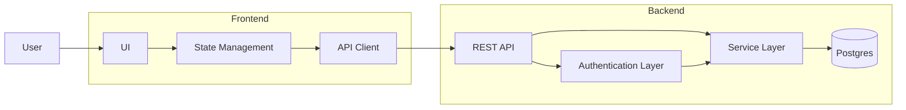
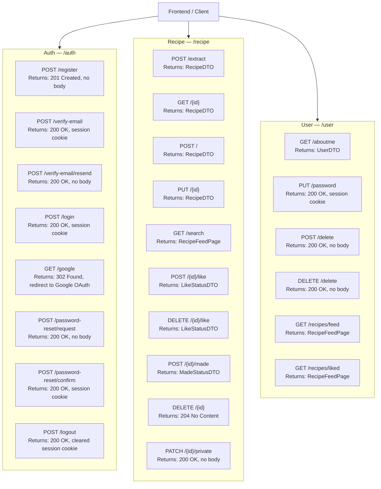
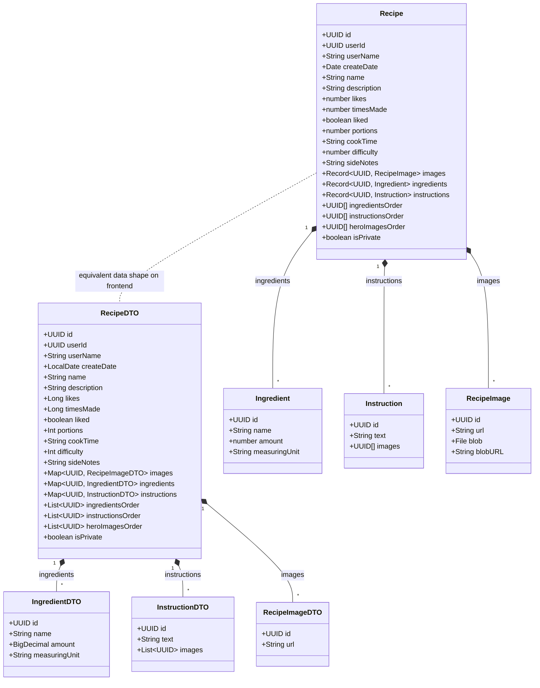

# Architecture and Models

## Application Interaction

## Backend Endpoints

Endpoint paths are relative to their group prefix. `RecipeDTO` is the recipe response model; feed endpoints return a page of recipes.

## Recipe Models

